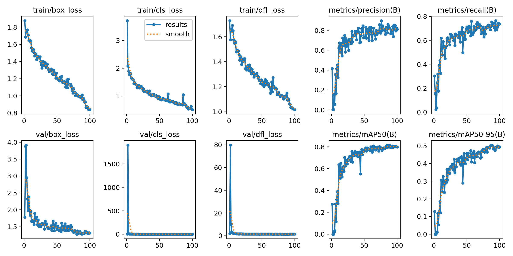
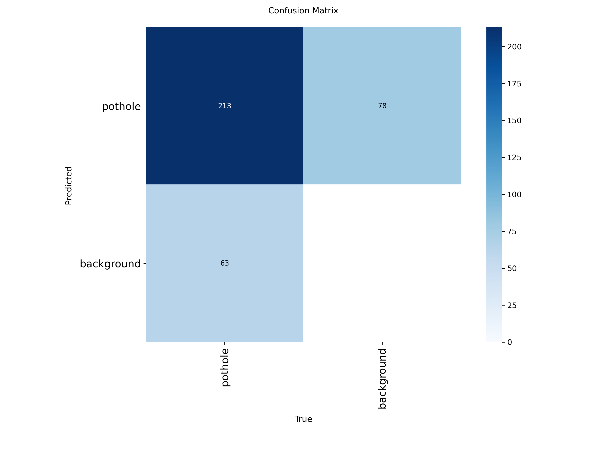

# Pothole Detection with YOLO11

YOLO11s ile yol çukuru (pothole) tespiti.

## Veri Seti
Kaggle "Pothole Detection" veri seti: 665 görüntü, PASCAL VOC formatı, tek sınıf (`pothole`).
Veri seti repoya dahil değildir, Kaggle'dan indirilmelidir.

Bölme: %70 train / %15 val / %15 test (100 test görüntüsü, 276 çukur).

## Model ve Eğitim
- Model: YOLO11s (COCO ön eğitimli, fine-tune)
- Giriş boyutu: 640
- Epoch: 100 (early stopping, patience=20)
- Optimizer: AdamW (Ultralytics auto)
- Framework: Ultralytics, Google Colab T4 GPU

## Test Sonuçları
| Precision | Recall | mAP50 | mAP50-95 |
|---|---|---|---|
| 0.799 | 0.717 | 0.802 | 0.491 |

### Eğitim Grafikleri


### Confusion Matrix (conf=0.25)


Satır: tahmin, sütun: gerçek.
- 213: doğru bulunan çukur
- 78: yanlış alarm
- 63: kaçırılan çukur
- Background × background kutusu detection'da hesaplanmadığı için boştur.

## Dosyalar
- `Untitled3.ipynb`: eğitim notebook'u
- `best.pt`: eğitilmiş model ağırlıkları
- `results.csv`: epoch bazlı metrikler
- `results.png`: loss ve metrik grafikleri
- `confusion_matrix.png`: test confusion matrix

## Kullanım
```python
from ultralytics import YOLO

model = YOLO("best.pt")
model.predict("resim.jpg", save=True, conf=0.25)
```

## Sınırlamalar
- Küçük veri seti (665 görüntü), farklı şehir/kamera/ışık koşullarında performans düşebilir.
- Gölge, yama ve ıslak asfalt yanlış alarm üretebilir.
- Bu model karar destek amaçlıdır, tek başına yol bakım kararı için kullanılmamalıdır.

## Lisans
Veri seti lisansı için Kaggle sayfasını kontrol edin.
